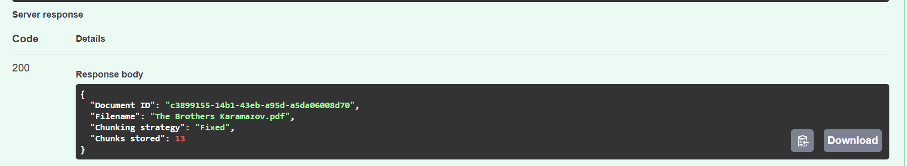

# Palmmind AI : Document Ingestion with REST API

This is a FastAPI Backend where a REST API is built for document ingestion. It uploads `.pdf` and `.txt` files, extracts the text, splits it into chunks, converts the chunks into embeddings, stores them in Pinecone and saves the metadata in SQLite database.

## How it works

1. Upload a `.pdf` or `.txt` file to `/ingest`.
2. Text is extracted (`pypdf` for PDFs, direct read for TXT).
3. Text is split into chunks using either Fixed chunking or Paragraph chunking strategy.
4. Each chunk is converted into a 384-dimension vector using `all-MiniLM-L6-v2` (sentence-transformers).
5. Vectors and chunk text are stored in a Pinecone index called `documents`.
6. Document metadata is saved in a local SQLite database (`Metadata.db`).

## Chunking strategies

| Strategy    | Description                                                              |
|-------------|--------------------------------------------------------------------------|
| `Fixed`     | Splits text into 500 characters chunks with a 50 characters overlap.       |
| `Paragraph` | Splits text by line breaks and groups lines where each chunk consists of a paragraph. |

## Tech stack

- FastAPI
- Pinecone (Vector Database)
- sentence-transformers (Embedding model)
- SQLite (Database)
- pypdf (PDF text extraction)

## Setup

1. Clone the repository and go into the folder.

2. Create and activate a virtual environment.

   ```
   python -m venv .venv
   .venv\Scripts\activate
   ```

3. Install dependencies.

   ```
   pip install -r requirements.txt
   ```

4. Create a Pinecone account and get an API key.

5. Create a file named `Pinecone_API.env` in the project folder with:

   ```
   pinecone_api_key=your_key_here
   ```

## Running the FastAPI server

From the project folder, with the virtual environment activated:

```
uvicorn main:app --reload
```
The server runs at http://127.0.0.1:8000.
Interactive API docs (Swagger UI) are at http://127.0.0.1:8000/docs.
Press Ctrl+C in the terminal to stop the server.

## Usage

Open `http://127.0.0.1:8000/docs` for the Swagger UI, or use curl:

```
curl -X POST "http://127.0.0.1:8000/ingest" \
  -F "file=@sample.pdf" \
  -F "chunking_strategy=Fixed"
```

### Endpoint

`POST /ingest`

| Field               | Type   | Description                                      |
|---------------------|--------|--------------------------------------------------|
| `file`              | file   | A `.pdf` or `.txt` document.                     |
| `chunking_strategy` | string | `Fixed` or `Paragraph` (default: `Fixed`).       |

### Example response

```json
{
  "Document ID": "c3063cf9-0578-4d8b-8a40-e6a7ee2a6de3",
  "Filename": "sample.pdf",
  "Chunking strategy": "Fixed",
  "No. of chunks stored": 13
}
```

### Errors

- `400`: unsupported file type, invalid chunking strategy or no text found in the file.

## Metadata

Each uploaded document is saved in the `documents` table of `Metadata.db`:

| Column              | Description                         |
|---------------------|-------------------------------------|
| `doc_id`            | Unique document ID (UUID)           |
| `filename`          | Original file name                  |
| `file_type`         | `pdf` or `txt`                      |
| `chunking_strategy` | Strategy used for chunking          |
| `chunk_count`       | Number of chunks stored             |
| `uploaded_at`       | Upload timestamp                    |

## Screenshots

### 1. Uploading the file


### 2. Extracting the text


### 3. Fixed chunking


### 4. Paragraph chunking


### 5. Embedding


### 6. Pinecone storage


### 7. Metadata in SQLite


## Limitation

- PDFs that have images only will return no text.

